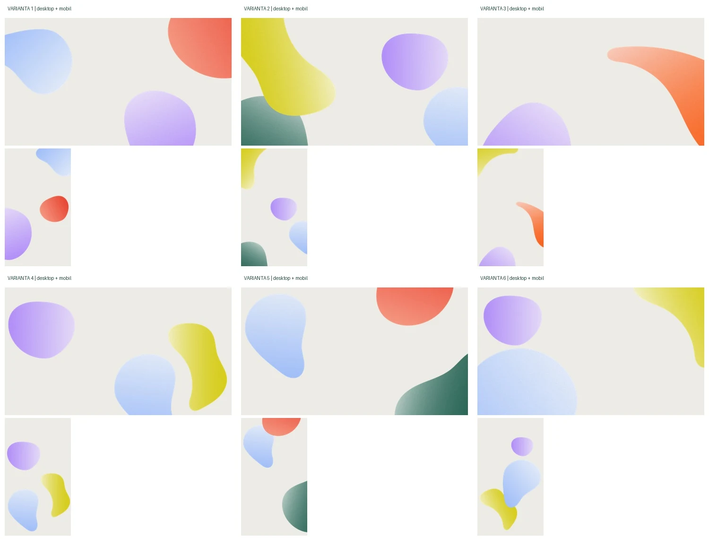

# Autorská pozadí Zahálky

## Výsledné řešení po vizuální připomínce, 25. 10. 2026

Zadání: původní barvy, celé tvary bez rovných spodních řezů, rozprostření po celé
obsahové části stránky a zachování dosavadního rozložení obsahu.

Původní pokus o zeslabené pozadí v hero sekcích je nahrazený. Grafika se nyní
nezesvětluje, nemá sníženou opacity, barevný filtr ani přidaný gradient. Tvary
zůstávají ve svých proporcích; neroztahují se do výšky spolu s dlouhou stránkou.



| Varianta | Použití | Kompoziční role |
| --- | --- | --- |
| 1 | Celá obsahová část homepage | Modrá, korálová a fialová rámují jednotlivé části stránky. |
| 2 | Celá obsahová část Příměšťáku | Pestřejší hravá paleta pro dětský program. |
| 3 | Celá obsahová část Programu, detailů akcí, Cookies a 404 | Oranžový a fialový motiv; mobil obsahuje i původní žlutou. |
| 4 | Celá obsahová část přehledu Blogu | Chladnější fialová a modrá se žlutým akcentem. |
| 5 | Celá obsahová část O nás a Kontaktu | Společná modrá, korálová a zelená pro stránky o prostoru. |
| 6 | Samostatná ilustrace newsletteru | Úplná dodaná kompozice vedle informací na desktopu, za nimi na mobilu. Její rozložení se při opravě nemění. |

Po následné kontrole překryvů jsou všechny dekorace stránek umístěné do volných
bočních okrajů. Jejich šířka vychází z nejširšího obsahu konkrétní stránky, takže
nezasahují pod text, tlačítka, fotografie ani postavičku na homepage. Na užších
obrazovkách se zmenšují; poslední celý tvar má větší akcent v existujícím spodním
odsazení. Do 340 px se drobné pravé motivy přesouvají vlevo kvůli kartám programu.
Samostatná ilustrace newsletteru zachovává původní kompozici. Barvy a bitmapy
se při této opravě nemění.

### Větší motivy na desktopu

Od 1101 px mají stránkové motivy limit šířky 26rem místo 14rem. Výpočet využívá
i volné vnitřní odsazení obsahových sloupců. Na homepage dostaly modrý a korálový
tvar samostatné umístění vedle užšího úvodu; korálový motiv má limit 32rem.
Při šířce 1470 px měří modrý motiv přibližně 324 px a korálový 412 px
(oba dříve 162 px). Mobilní a tabletové kompozice do 1100 px se nemění.

Po zvětšení prošlo všech 16 stránek v šířkách 390, 1024, 1101, 1280, 1470,
1600, 1920 a 2560 px kontrolou průniků dekorací s textem, obrázky a ovládáním:
128 kombinací skutečného obsahu a dalších 128 kombinací v izolované kopii
s budoucími akcemi, aktivními přihláškami na tábor a formulářem newsletteru.
V těchto stavech nebyly nalezené kolize. Produkční build znovu prošel.

## Proč bylo potřeba použít SVG zdroje

PNG exporty už některé tvary ořezávají hranicí původní kreslicí plochy. Samotné
odstranění CSS ořezu nebo přepnutí na `contain` by tuto rovnou hranu neopravilo.
Dodaný SVG export ale obsahuje celé bitmapy tvarů a jejich původní masky.

Skript odstraní pouze vnější obdélníkový klip kreslicí plochy. Původní masky,
barvy, zrnitost, vnitřní klipy a natočení jednotlivých tvarů zachovává. Každý
celý tvar se optimalizuje do WebP. Svislé polohy vycházejí z dodané kompozice
a přizpůsobují se délce stránky; vodorovně tvary rámují obsah v okrajích.
Okolo všech tvarů je odstup od
okraje, takže se nedotýkají hrany hero sekce ani patičky.

## Soubory a obnovení podkladů

- Originály: `/Users/tomaskucera/Downloads/grafika`, varianty 1–6, desktop a mobil.
- `scripts/pripravit-vrstvy-pozadi.py`: příprava celých vrstev z SVG pro varianty 1–6.
- `scripts/vykreslit-vrstvu.mjs`: SVG renderer přes lokální sharp ze závislostí Astro.
- `src/data/pozadi.json`: rozměry a relativní polohy pro obě kompozice.
- `public/obrazky/pozadi/vrstvy/`: 37 optimalizovaných úplných tvarů. Zdrojová SVG o desítkách MB se neposílají do prohlížeče.
- `src/components/PozadiStranky.astro`: jednotlivé vrstvy přes celou obsahovou část, bez JS.
- `src/layouts/Zaklad.astro`: prop `pozadi`, společná vrstva za obsahem. Hlavička a patička zachovávají dosavadní tok.
- `src/components/GrafickePozadi.astro`: samostatná kompozice newsletteru z úplných tvarů, v původních rozměrech a barevnosti.
- Starší WebP celých kreslicích ploch jsou zachované jako podklady předchozí verze. Původní skript pro převod PNG zůstává pro jejich obnovení.

Obnovení celých vrstev (Pillow + nainstalované závislosti projektu):

```sh
python3 scripts/pripravit-vrstvy-pozadi.py /cesta/ke/grafika
```

Kompozice se přepínají při 700 px. Skrytá kompozice má v `picture` průhledný
fallback a nenačítá bitmapy pro druhé zařízení. Dekorace mají prázdný alt,
`aria-hidden`, rozměry a neodchytávají kliknutí. Vrstvy ve spodní části stránky
se načítají lazy. Nepoužívá se `cover`, opakování pozadí, barevné úpravy ani JS
pro polohování.

## Ověření opravy

Aktuální kontrola je popsaná v [protokolu kontroly překryvů](kontrola-prekryvu-2026-10-25.md).
Zahrnuje všech 16 generovaných stránek, deset šířek, dočasně naplněný program,
aktivní přihlášky i formulář newsletteru. Dekorace se nepřekrývají s textem,
obrázky ani ovládacími prvky v ověřených stavech. Rozměry a tok obsahu nejsou
předmětem úprav; mění se umístění dekorací a barvy špatně čitelných prvků.

Aktuální skutečný obsah nemá budoucí akce ani aktivní přihlášky na tábor;
newsletter bez nastaveného formuláře zobrazuje kontaktní e-mail. Testovací
obsah vznikl pouze v dočasné kopii a nepatří do publikovaného webu.
